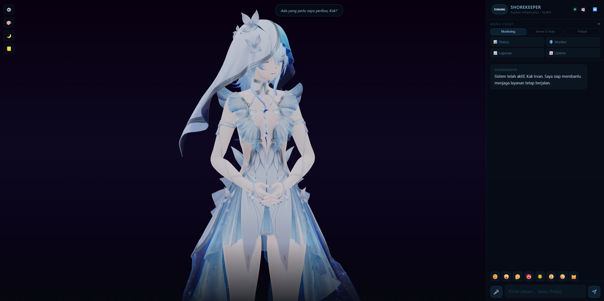
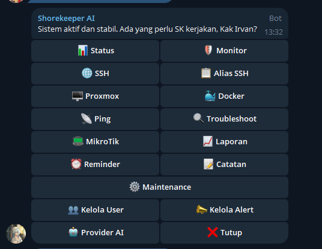
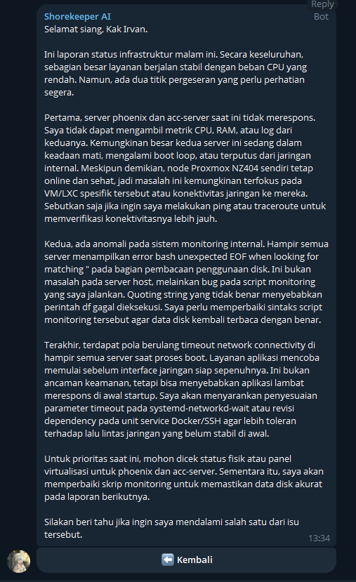

<div align="center">

# 🛡️ Shorekeeper Project

**AI Homelab Infrastructure Assistant**

*Berbasis karakter Shorekeeper dari Wuthering Waves*

[](https://nodejs.org)
[](https://www.typescriptlang.org)
[](https://pm2.keymetrics.io)
[](https://mariadb.org)
[](https://platform.openai.com/docs/api-reference)
[](https://core.telegram.org/bots)

<p align="center">
  
  <br>
  <i>"The silent guardian of your infrastructure, weaving safety within the flow of data."</i>
</p>

### 🖼️ Preview Dashboard

<p align="center">
  <a href="./public/model3d/preview2.png">
    
  </a>
</p>
<p align="center"><i>Dashboard web dengan model 3D, menu cepat, dan chat AI.</i></p>

<p align="center">
  <a href="./public/model3d/preview3.png">
    
  </a>
</p>
<p align="center"><i>Menu utama bot Telegram untuk mengakses fitur Shorekeeper.</i></p>

<p align="center">
  <a href="./public/model3d/preview4.png">
    
  </a>
</p>
<p align="center"><i>Contoh laporan infrastruktur melalui bot Telegram.</i></p>

</div>

---

## 📖 Overview

Shorekeeper (SK) adalah AI asisten infrastruktur pribadi yang berjalan sebagai **Telegram bot** sekaligus **web dashboard**. SK memantau, menganalisis, dan membantu mengelola server secara real-time.

Persona percakapan SK memakai karakter orisinal yang tenang, empatik, dan
berorientasi pada keandalan sistem. Balasan persona ditampilkan tanpa emoji;
reaksi model web mengikuti konteks dengan gestur yang lembut dan profesional.

Dashboard menampilkan model PMX 3D dari `public/model3d/Shorekeeper3D/` menggunakan Three.js. Renderer dan dependensi Three.js dimuat dari jsDelivr. Pose awal lengan diturunkan rileks sedikit ke depan di samping badan dan framing default memberi ruang di atas kepala serta di bawah kaki; setelan model lama diperbarui satu kali agar kepala tidak terpotong, dan skala/posisi tetap dapat disesuaikan dari panel model. Gerak idle orisinal menggunakan bone model untuk napas, pergeseran berat badan, kedipan, gerak kepala, rambut, dan rok; motion koreografi MMD memerlukan file `.vmd`. Model yang disertakan memiliki ketentuan penggunaan dari pembuatnya; jangan menjual atau mendistribusikan ulang model maupun teksturnya.


### ✨ Fitur Utama

- Monitoring CPU, RAM, Disk via SSH dengan alert otomatis
- Proxmox: lihat status VM/LXC, start/stop/reboot
- Docker: list container, start/stop/restart, lihat log
- Ping monitor HTTP dan IP dengan notifikasi up/down
- Auto-fix untuk beberapa kasus masalah umum
- Laporan otomatis pagi & malam berbasis AI (provider OpenAI-compatible)
- Reminder dan notes (tag, pencarian)
- Uptime history dan grafik downtime
- Web dashboard dengan model PMX 3D, chat AI, quick action, dan command
- Command chat (WEB CHAT): /ping /ssh /docker /proxmox /laporan /help

---

## ⚙️ Requirements

- Node.js 18.x LTS atau lebih baru
- PM2 global (`npm install -g pm2` — Note: Pasang PM2 secara global.)
- MariaDB 10.6+ / MySQL 8+
- TypeScript 5.x (dev dependency)

> Catatan: Panduan install ini baru diuji di Debian 12. OS/distro lain mungkin memerlukan penyesuaian paket dan path.

---

## 🚀 Instalasi & Jalankan (Step-by-step)

1. Clone repo
```bash
# Note: Unduh repository ke direktori instalasi Shorekeeper.
git clone https://github.com/nz404/shorekeeper.git /opt/shorekeeper
# Note: Masuk ke direktori repository untuk menjalankan langkah berikutnya.
cd /opt/shorekeeper
```

2. Install dependensi
```bash
# Note: Pasang dependensi sesuai lockfile agar versi paket konsisten.
npm ci
```

Jalankan instalasi dependensi langsung di mesin Linux yang menjalankan Shorekeeper.
Jangan menyalin `node_modules` dari Windows atau OS lain: paket native seperti
`canvas` harus memiliki binary yang cocok dengan OS, arsitektur, dan versi Node.js
server. Folder `node_modules` sudah dikecualikan dari Git.

3. Install MariaDB (jika belum terpasang)
```bash
# Note: Perbarui daftar paket Debian/Ubuntu.
sudo apt update && sudo apt install -y mariadb-server
# Note: Aktifkan MariaDB saat boot dan jalankan sekarang.
sudo systemctl enable --now mariadb
```

4. Copy dan edit `.env`
```bash
# Note: Buat file konfigurasi lokal dari template.
cp .env.example .env
# Note: Atur nilai di .env sesuai environment Anda.
```

`.env.example` hanya memuat variabel environment yang masih dibaca oleh source
saat ini. Nilai konfigurasi Proxmox, MikroTik, user bot, dan jadwal yang dikelola
melalui menu admin disimpan di database, bukan melalui variabel `PVE_*` atau
`WEB_GUEST_*` lama. `TELEGRAM_ALLOWED_USER_IDS` hanya disediakan sebagai opsi
migrasi konfigurasi lama; pengelolaan user baru dilakukan melalui menu admin.

Untuk koneksi database, isi `DB_HOST`, `DB_USER`, `DB_PASSWORD`, dan `DB_NAME`.
`DB_PORT` opsional dan default ke `3306` (port standar MySQL/MariaDB). Jika
database berada di server lain, pastikan host dan port tersebut dapat dijangkau
dari mesin yang menjalankan Shorekeeper.

Untuk login web, setel `WEB_ADMIN_USER` dan `WEB_PASSWORD` di `.env`.
Password wajib minimal 8 karakter; tidak ada lagi akun demo atau kredensial
default. Buat password unik dan panjang, jangan menggunakannya ulang di layanan
lain. Login web hanya mengeluarkan sesi admin.

### Konfigurasi AI

Semua fitur AI Shorekeeper (chat Telegram/web, persona, laporan, analisis log,
troubleshooting, dan auto-fix) menggunakan satu provider/model lewat API
Chat Completions OpenAI-compatible. Provider dapat diatur admin lewat menu
Telegram **/start** (Note: buka menu utama bot) → **🤖 Provider AI** tanpa
mengedit `.env`. Pilih provider,
kirim API key melalui chat pribadi admin, lalu masukkan model ID dan endpoint
(pilih `default` untuk URL bawaan). Konfigurasi tersimpan di database dan
berlaku langsung untuk chat Telegram/web, persona, laporan, analisis log,
troubleshooting, serta auto-fix. API key tidak ditampilkan kembali; Shorekeeper
mencoba menghapus pesan Telegram yang berisi key, tetapi hapus manual jika
pesannya masih terlihat. Simpan database dengan akses terbatas karena API key
disimpan di sana.

Untuk setup awal/otomatisasi tanpa menu, konfigurasi yang sama tetap bisa
disediakan dari `.env` sebagai fallback:

```env
AI_PROVIDER=groq
AI_API_KEY=api-key-anda
AI_MODEL=model-id-provider
```

Provider dan endpoint bawaan:

| `AI_PROVIDER` | Endpoint bawaan (`AI_BASE_URL` opsional) | API key dan model |
|---|---|---|
| `groq` | `https://api.groq.com/openai/v1` | Groq API key dan model ID dari Groq |
| `openai` | `https://api.openai.com/v1` | OpenAI API key dan model ID yang tersedia di akun |
| `openrouter` | `https://openrouter.ai/api/v1` | OpenRouter API key dan model ID dari katalog OpenRouter |
| `gemini` | `https://generativelanguage.googleapis.com/v1beta/openai/` | Gemini API key dari Google AI Studio dan model ID yang didukung |
| `9router` | `http://127.0.0.1:20128/v1` | API key dan model ID dari dashboard 9Router |
| `custom` | Wajib diisi | API key dan model ID milik endpoint tersebut |

Contoh Groq (default):

```env
AI_PROVIDER=groq
AI_API_KEY=groq-api-key-anda
AI_MODEL=model-id-dari-konsol-groq
```

Contoh OpenAI:

```env
AI_PROVIDER=openai
AI_API_KEY=openai-api-key-anda
AI_MODEL=model-id-yang-tersedia-di-openai
```

Contoh OpenRouter:

```env
AI_PROVIDER=openrouter
AI_API_KEY=openrouter-api-key-anda
AI_MODEL=provider/model-id-dari-katalog-openrouter
```

Contoh 9Router yang berjalan pada mesin yang sama dengan Shorekeeper:

```env
AI_PROVIDER=9router
AI_BASE_URL=http://127.0.0.1:20128/v1
AI_API_KEY=api-key-dari-dashboard-9router
AI_MODEL=model-id-yang-tersedia-di-9router
```

Salin API key dan model ID dari dashboard 9Router. Jika 9Router berjalan di
mesin/container lain, ganti `AI_BASE_URL` dengan alamat yang dapat dijangkau
dari server Shorekeeper; `127.0.0.1` hanya menunjuk ke mesin/container
Shorekeeper sendiri.

Gemini bisa dipakai melalui endpoint OpenAI-compatible resmi Google:

```env
AI_PROVIDER=gemini
AI_API_KEY=gemini-api-key-anda
AI_MODEL=model-id-gemini-yang-tersedia
```

`AI_MODEL` harus diisi dengan nama model Gemini yang tersedia pada API/key
Google Anda. Dokumentasi: [Gemini OpenAI compatibility](https://ai.google.dev/gemini-api/docs/openai).

Untuk provider lain, set `AI_PROVIDER=custom`, `AI_BASE_URL` ke base URL API
OpenAI-compatible, lalu isi `AI_API_KEY` dan `AI_MODEL`. Shorekeeper memakai
endpoint Chat Completions. Kompatibilitas provider pihak ketiga bergantung pada
dukungan format tersebut; fitur khusus seperti API native, tool calling
provider, atau format output tertentu tidak otomatis didukung.

Konfigurasi yang disimpan admin dari Telegram di database mengesampingkan
nilai fallback `.env`. Menu admin **👥 Kelola User** menyimpan user biasa yang
diizinkan ke database; `TELEGRAM_ADMIN_USER_IDS` tetap untuk menetapkan admin
awal. Variabel lama `GROQ_API_KEY` dan `GROQ_MODEL` sudah tidak dipakai.
Jangan publikasikan API key atau commit `.env`.

Sebelum membuka layanan ke internet, pasang HTTPS melalui reverse proxy (misalnya
Nginx/Caddy), batasi akses langsung ke port aplikasi, dan izinkan hanya proxy
tersebut mengaksesnya. Jika proxy berada di IP tepercaya, atur `WEB_TRUST_PROXY`
ke IP/CIDR proxy yang tepat (contoh `127.0.0.1`); jangan set ke `true` atau
memercayai header proxy dari klien publik. Simpan `.env` dengan izin file
terbatas dan jangan pernah memublikasikannya.

Atur admin bot di `.env` menggunakan Telegram **user ID** (bukan grup chat ID):
```env
TELEGRAM_ADMIN_USER_IDS=123456789,987654321
```
`MY_CHAT_ID` juga otomatis dianggap admin untuk kompatibilitas. Admin menambah
user lewat tombol **👥 Kelola User** di menu `/start` (Note: buka menu utama bot)
pada chat pribadi bot.
Menu ini hanya ditampilkan kepada admin. Admin dapat menambahkan ID, melihat
daftar user, mengganti ID user lewat tombol **Edit**, dan mencabut akses dengan
tombol **Hapus**. Perintah `/users add <id>` (Note: tambahkan user yang
diizinkan), `/users` (Note: tampilkan daftar user), dan `/users remove <id>`
(Note: cabut akses user) tetap tersedia. Daftar user disimpan di database.
`TELEGRAM_ALLOWED_USER_IDS` lama akan diimpor ke database saat startup
agar konfigurasi lama tetap berfungsi.

Jadwal laporan harian bisa diatur di menu **📈 Laporan → ⏰ Atur Jadwal
Laporan**. Jadwal pagi dan malam dapat dinyalakan atau dimatikan secara
terpisah; jam dan statusnya disimpan di database, sehingga tetap berlaku
setelah Shorekeeper restart. Waktu mengikuti `TIMEZONE` di `.env`.
Di submenu **📬 Atur Tujuan Laporan**, admin dapat memilih PM dan grup untuk
menerima laporan terjadwal. Laporan pagi/malam dan mingguan mengikuti daftar
tujuan ini, yang terpisah dari penerima alert. PM admin tetap menjadi tujuan
default sampai dinonaktifkan dari submenu tersebut. Grup harus terdeteksi
terlebih dahulu dengan bot ditambahkan ke grup atau menerima pesan/update grup.

Di menu Telegram, catatan, reminder, target ping, alias SSH, perangkat MikroTik,
dan cluster Proxmox yang tersimpan juga dapat diedit dari tombol **Edit** di
item/menu masing-masing. Edit credentials SSH/MikroTik/Proxmox dilakukan melalui
chat pribadi bot. Perubahan catatan dan reminder tetap dibatasi ke pemilik item;
gunakan `/cancel` (Note: batalkan input edit yang sedang berlangsung).

User yang terdaftar bisa memakai bot di chat pribadi maupun grup. Tambahkan bot
ke grup; perintah slash bisa dipanggil di sana oleh user yang sudah diizinkan.
Untuk membaca pesan teks biasa (bukan perintah atau mention), nonaktifkan
Privacy Mode bot lewat BotFather. Pengelolaan daftar user hanya dapat dilakukan
admin melalui chat pribadi bot.

Tujuan alert dapat diatur langsung di `.env` dengan satu atau beberapa Telegram
chat ID, dipisahkan koma. Gunakan ID pengguna untuk chat pribadi atau ID negatif
untuk grup/supergrup:
```env
TELEGRAM_ALERT_CHAT_IDS=123456789,-1001234567890
```
Tambahkan bot ke grup penerima. `MY_CHAT_ID` (PM admin) awalnya berlangganan
secara default. Jika alert terkirim ke PM dan grup sekaligus, buka menu admin
**📣 Kelola Alert** di chat pribadi bot lalu matikan tujuan PM atau tujuan
lainnya. Status di database mengesampingkan `.env` untuk chat tersebut, jadi
chat yang dimatikan tidak akan menerima alert walau ID-nya masih tercantum di
`.env`. Tujuan bertanda `[env]` berasal dari `TELEGRAM_ALERT_CHAT_IDS`.

Grup terdeteksi otomatis saat bot ditambahkan ke grup atau menerima pesan di
grup, lalu muncul di menu **📣 Kelola Alert** (hanya admin, chat pribadi).
Telegram tidak menyediakan API untuk mengambil daftar grup yang sudah dimasuki
sebelum fitur ini; grup lama akan muncul setelah ada update/pesan baru dari
grup itu. Deteksi grup tidak otomatis menyalakan alert. Pilih grup di menu
untuk mengaktifkan alert; `/alerts on` (Note: aktifkan alert untuk chat saat ini)
dan `/alerts off` (Note: nonaktifkan alert untuk chat saat ini) di chat juga
tetap bisa dipakai. Gunakan `/alerts status` (Note: periksa status alert chat
saat ini).
Menu ini mengatur notifikasi alert monitor (misalnya server down/CPU tinggi);
laporan terjadwal dan reminder memiliki tujuan pengiriman masing-masing.

5. Buat database (via MySQL/MariaDB CLI)
```bash
# Note: Masuk ke MySQL sebagai root atau user admin lain.
mysql -u root -p

-- Note: Buat database dengan encoding yang mendukung Unicode.
CREATE DATABASE shorekeeper_db CHARACTER SET utf8mb4 COLLATE utf8mb4_unicode_ci;
-- Note: Buat user aplikasi lokal dengan password yang kuat.
CREATE USER 'shorekeeper'@'localhost' IDENTIFIED BY 'password_kuat';
-- Note: Berikan akses database hanya kepada user aplikasi.
GRANT ALL PRIVILEGES ON shorekeeper_db.* TO 'shorekeeper'@'localhost';
-- Note: Terapkan perubahan hak akses.
FLUSH PRIVILEGES;
-- Note: Keluar dari MySQL setelah konfigurasi selesai.
EXIT;
```

6. Build TypeScript dan jalankan PM2
```bash
# Note: Siapkan direktori untuk log aplikasi.
mkdir -p /opt/shorekeeper/logs
# Note: Kompilasi source TypeScript ke direktori dist.
npm run build
# Note: Jalankan aplikasi menggunakan konfigurasi PM2 repository.
pm2 start ecosystem.config.js
# Note: Simpan daftar proses PM2 saat ini agar bisa dipulihkan.
pm2 save
# Note: Buat konfigurasi startup PM2 untuk server.
pm2 startup
```

7. Cek status
```bash
# Note: Periksa status proses yang dikelola PM2.
pm2 status
# Note: Ikuti log proses Shorekeeper secara langsung.
pm2 logs shorekeeper
```

Jika log menampilkan `canvas.node: invalid ELF header`, binary `canvas` di
`node_modules` tidak cocok dengan Linux. Hentikan proses, instal ulang dependensi
di server, bangun ulang native module `canvas`, lalu jalankan hasil build lewat
PM2:
```bash
# Note: Pindah ke direktori instalasi aplikasi.
cd /opt/shorekeeper
# Note: Hentikan proses agar dependensi dapat diperbarui dengan aman.
pm2 stop shorekeeper
# Note: Instal ulang dependensi di mesin Linux yang menjalankan aplikasi.
npm ci
# Note: Bangun ulang binary canvas untuk environment server.
npm rebuild canvas --build-from-source
# Note: Pastikan binary canvas yang terbentuk menggunakan format ELF.
file node_modules/canvas/build/Release/canvas.node
# Note: Kompilasi ulang source TypeScript.
npm run build
# Note: Hapus proses lama dari daftar PM2 sebelum menjalankan konfigurasi baru.
pm2 delete shorekeeper
# Note: Jalankan kembali aplikasi melalui konfigurasi PM2.
pm2 start ecosystem.config.js
# Note: Simpan daftar proses PM2 setelah aplikasi berjalan.
pm2 save
```
Pastikan keluaran `file` menunjukkan binary `ELF`. Jalankan perintah tersebut
langsung di server Linux, bukan di Windows lalu menyalin `node_modules` atau
`dist` hasil build lintas OS. Konfigurasi PM2 menjalankan `npm start` (Note:
jalankan aplikasi dari hasil build TypeScript di `dist`).

Jika instalasi `canvas` gagal saat membangun native module, pasang prasyarat
build di Debian/Ubuntu lalu ulangi `npm ci`:
```bash
# Note: Perbarui daftar paket Debian/Ubuntu.
sudo apt update
# Note: Pasang compiler dan library yang diperlukan untuk membangun canvas.
sudo apt install -y build-essential python3 pkg-config libcairo2-dev libpango1.0-dev libjpeg-dev libgif-dev librsvg2-dev
```

---

## 🗄️ Menambahkan Proxmox untuk di Monitor

Di versi ini, setup Proxmox sudah ada di menu Telegram dan web dashboard.

1. Buka Telegram bot Shorekeeper, kirim `/start` (Note: buka menu utama bot).
2. Pilih menu `Proxmox` lalu ikuti langkah konfigurasinya (host, port, user, token/API key).
3. Atau buka web dashboard, login sebagai admin, dan pilih Proxmox di menu.
4. Restart Shorekeeper hanya jika ada setting yang mengharuskan reload layanan.

---

## 📌 PM2 Quick Commands

- `pm2 start ecosystem.config.js` — Note: Jalankan Shorekeeper sesuai konfigurasi
  PM2.
- `pm2 stop shorekeeper` — Note: Hentikan proses Shorekeeper tanpa menghapus
  konfigurasi proses.
- `pm2 restart shorekeeper` — Note: Restart proses Shorekeeper.
- `pm2 reload shorekeeper` — Note: Muat ulang proses Shorekeeper melalui PM2.
- `pm2 logs shorekeeper` — Note: Tampilkan log Shorekeeper.
- `pm2 monit` — Note: Buka monitor interaktif untuk penggunaan resource proses
  PM2.

---

## 💬 Contoh Command Web Chat

- `/help` — Note: Tampilkan daftar command yang tersedia.
- `/ping` — Note: Periksa status target ping yang dikonfigurasi.
- `/proxmox` — Note: Buka informasi dan aksi Proxmox yang tersedia.
- `/ssh` — Note: Buka informasi atau menu perangkat SSH yang dikonfigurasi.
- `/ssh [alias] [cmd]` — Note: Jalankan perintah pada host SSH dengan alias
  yang terdaftar.
- `/docker [alias]` — Note: Tampilkan atau kelola container Docker pada alias
  yang terdaftar.
- `/laporan` — Note: Minta laporan status infrastruktur.

---

<div align="center">
Shorekeeper Project - Developed by <a href="https://nz404.my.id">Nz404</a>
</div>
